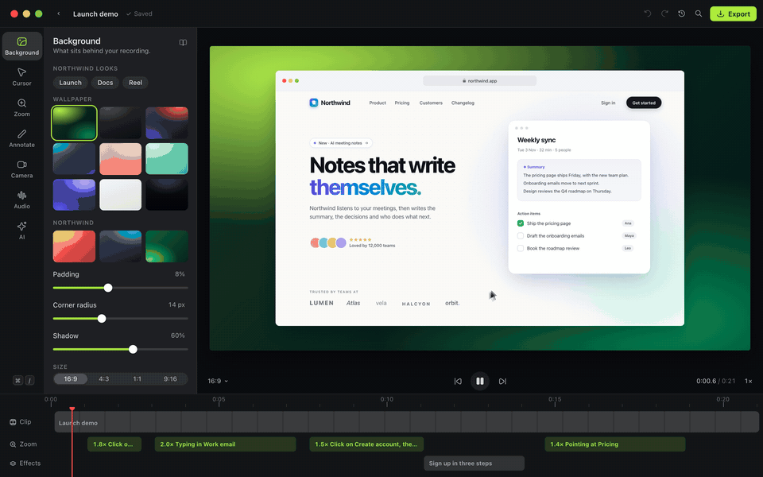
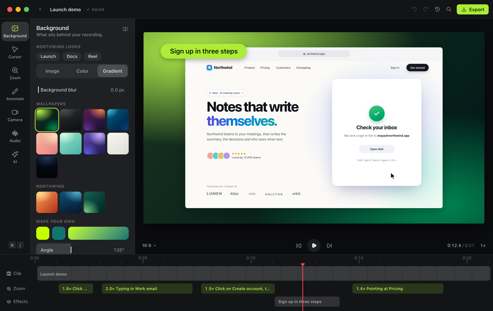
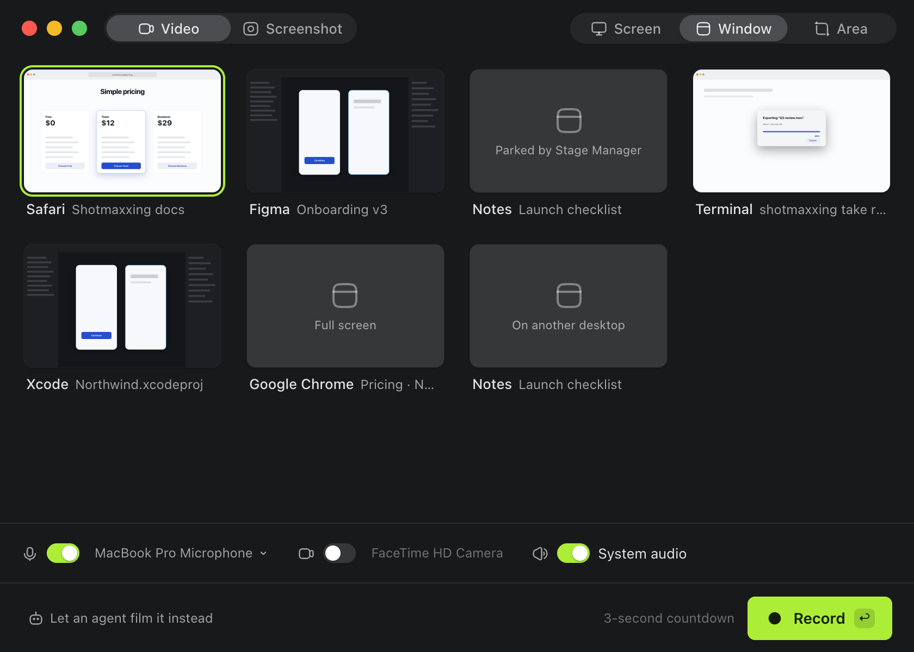
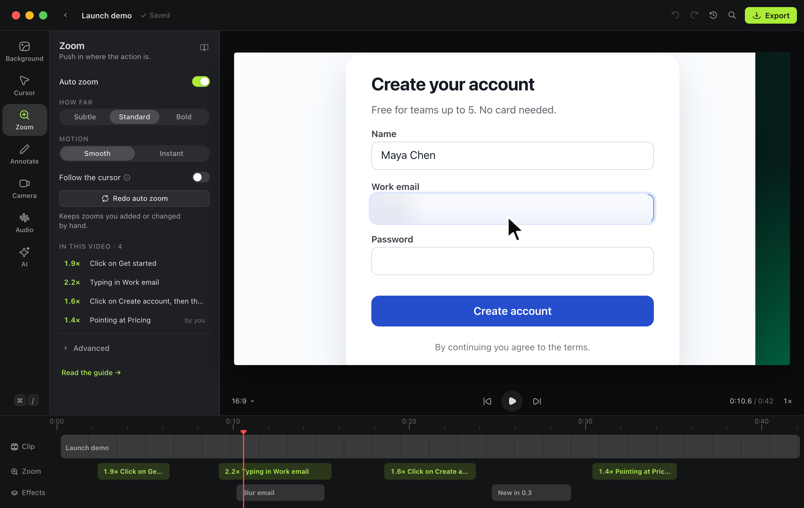
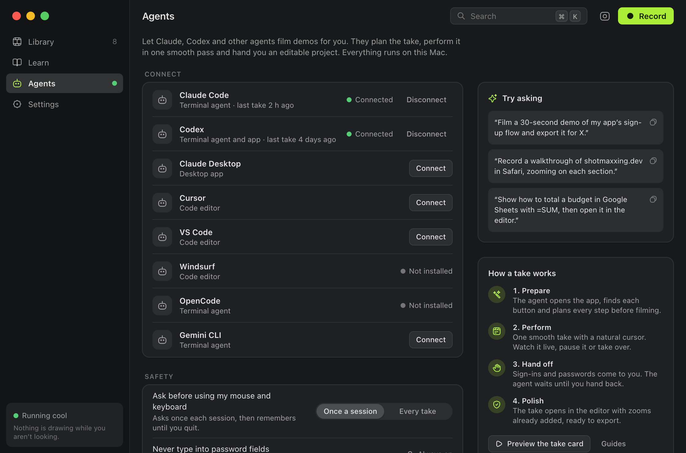
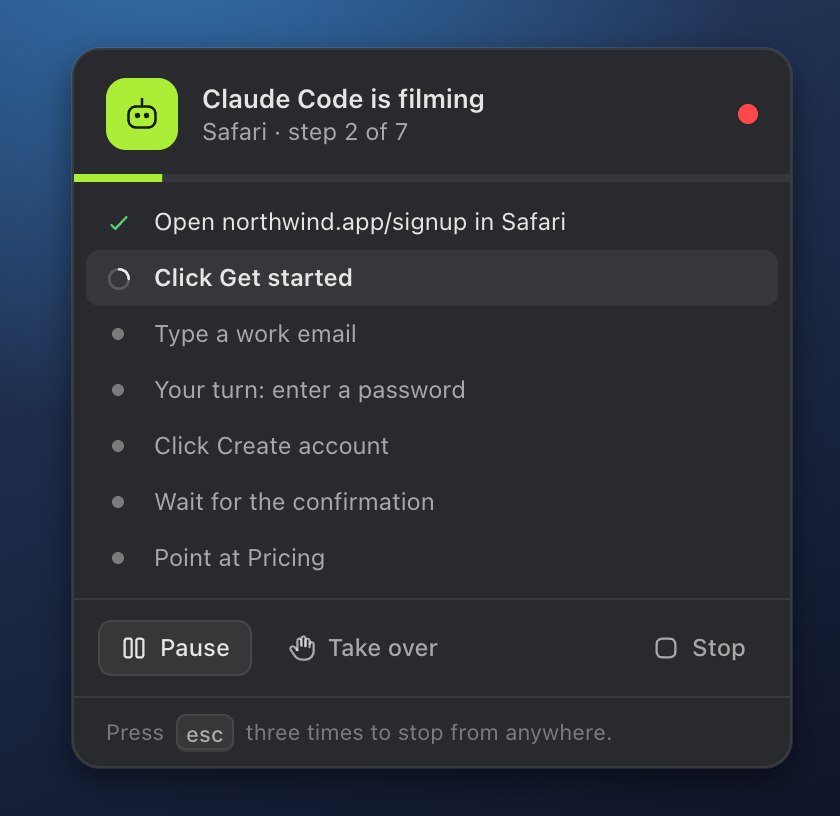

<p align="center">
  
</p>

<h1 align="center">Shotmaxxing</h1>

<p align="center">
  Record demos that edit themselves. Record your screen by hand, or let an AI agent such as Claude or Codex film it.
  Shotmaxxing adds the zooms, smooths the cursor and keeps your computer cool while it works.
</p>

<p align="center">
  <a href="#install">Install</a> ·
  <a href="docs/guides/README.md">Guides</a> ·
  <a href="docs/agents.md">Agents</a> ·
  <a href="docs/architecture.md">Architecture</a> ·
  <a href="docs/roadmap.md">Roadmap</a>
</p>

<p align="center">
  
</p>

## Install

**macOS 14 or later.** Paste this into Terminal:

```sh
curl -fsSL https://shotmaxxing.app/install | bash
```

**Windows 10 (version 2004) or later, 64-bit.** Paste this into PowerShell:

```powershell
irm https://shotmaxxing.app/install.ps1 | iex
```

Each line downloads the current release from GitHub, checks it against its SHA-256, installs it and opens it, with
no "Not Opened" dialog on the Mac and no SmartScreen warning on Windows. On a Mac it goes in Applications, and the
`shotmaxxing` command is linked into a folder on your PATH when one is yours to change. On Windows it installs for
your user, without administrator rights. Run the same line again to update. Both scripts are short, so you can read
[install.sh](install.sh) or [install.ps1](install.ps1) before you run them.

**With Homebrew** on a Mac. The app opens on the first click this way too, the `shotmaxxing` command goes on your
PATH, and `brew upgrade` updates it:

```sh
brew tap subh05sus/shotmaxxing https://github.com/subh05sus/shotmaxxing
brew install --cask subh05sus/shotmaxxing/shotmaxxing
```

<details>
<summary><b>Or download the installer yourself</b></summary>

| Computer | File |
| --- | --- |
| Mac with Apple silicon | [Shotmaxxing_0.3.0_aarch64.dmg](https://github.com/subh05sus/shotmaxxing/releases/download/v0.3.0/Shotmaxxing_0.3.0_aarch64.dmg) |
| Mac with Intel | [Shotmaxxing_0.3.0_x64.dmg](https://github.com/subh05sus/shotmaxxing/releases/download/v0.3.0/Shotmaxxing_0.3.0_x64.dmg) |
| Windows, setup program | [Shotmaxxing_0.3.0_x64-setup.exe](https://github.com/subh05sus/shotmaxxing/releases/download/v0.3.0/Shotmaxxing_0.3.0_x64-setup.exe) |
| Windows, MSI | [Shotmaxxing_0.3.0_x64_en-US.msi](https://github.com/subh05sus/shotmaxxing/releases/download/v0.3.0/Shotmaxxing_0.3.0_x64_en-US.msi) |

The builds aren't notarized (macOS) or signed (Windows) yet, so a file downloaded in a browser gets one warning the
first time it opens:

- **macOS:** drag Shotmaxxing to Applications and open it. When "Shotmaxxing.app Not Opened" appears, choose
  **Done**, not Move to Trash. Then open **System Settings → Privacy & Security**, scroll down and choose **Open
  Anyway**. Or clear the download mark in Terminal instead: `xattr -dr com.apple.quarantine /Applications/Shotmaxxing.app`
- **Windows:** when SmartScreen says "Windows protected your PC", choose **More info → Run anyway**.

Every version is on the [Releases](https://github.com/subh05sus/shotmaxxing/releases) page.

</details>

<details>
<summary><b>Uninstall</b></summary>

- **macOS:** quit Shotmaxxing and drag it from Applications to the Trash. If the install line linked the
  `shotmaxxing` command, remove the link it named, such as `rm /usr/local/bin/shotmaxxing`. With Homebrew:
  `brew uninstall --cask shotmaxxing`.
- **Windows:** Settings → Apps → Installed apps → Shotmaxxing → Uninstall.

Your recordings and projects stay where they are.

</details>

On macOS, Shotmaxxing needs Screen Recording to record. The microphone and the camera are asked for when you turn
them on, and Accessibility lets auto zoom notice clicks and typing and lets agents press buttons. The onboarding
walks you through each one and shows each switch live. Screen Recording starts working once Shotmaxxing reopens, and
setup has a button for that. From 0.2.1 on, the app in every release is signed with the same identity, so macOS
keeps the permissions when Shotmaxxing updates. If System Settings shows a switch as on but setup still asks for it,
macOS is matching the switch to an earlier copy of the app (builds before 0.2.1 looked like a new app to it after each
update, and so does 0.2.1 the first time): select Shotmaxxing in that list, remove it with the − button, and choose
Allow again.
Recording, export and agent takes on Windows are written but haven't been tested on a Windows computer yet, so expect
rough edges there. Linux isn't supported yet; it's on the [roadmap](docs/roadmap.md).

<picture>
  <source media="(prefers-color-scheme: light)" srcset="docs/images/editor-light.png">
  
</picture>

Open source (AGPL 3.0) and local first: recordings and projects stay on your computer. For macOS, with Windows on
the way.

## What it does

### Record

- **A display, a window or an area**, with the computer's sound, a microphone and a camera.
- **Window recordings keep their menus.** A dropdown or a sheet that opens over the window is recorded with it, and
  the recording follows the window if you move it.
- **Full-screen apps and Stage Manager** are handled: a full-screen app is recorded with its toolbars, and a window
  Stage Manager parked comes back to the stage first, at its own size.
- **Screenshots** with ⌥⇧4 (Alt+Shift+4 on Windows): a full-resolution picture of a screen or a window, opened in the
  editor to frame and mark up, then copied or saved as a PNG.
- ⌥⇧5 (Alt+Shift+5) starts a recording. A small pill shows while you record: stop with it, with ⌥⇧5 again, or from
  the menu bar. Shotmaxxing's own windows never appear in a recording, and clicks on them aren't recorded either.

<p align="center">
  
</p>

### Edit

- **Auto zoom** follows what you click and type, and says why each zoom is there. Choose how far it zooms and whether
  it glides or cuts, or add, move and remove zooms by hand.
- **A rendered cursor:** larger, smoothed, with click effects, a spotlight, motion blur and click sounds.
- **The look:** wallpapers, padding, rounded corners, shadow, and 16:9, 4:3, 1:1 or 9:16.
- **A timeline** to trim, split and speed up, with text, arrows and blur on top.
- **Sound:** voice cleanup and silence cutting on device, a voice-over recorded in the editor, and music under the
  whole video.
- **Captions** transcribed on your computer with Whisper, editable word by word, drawn into the video or saved as SRT
  or WebVTT.
- **A camera bubble**, autosave and version history.
- **Export** to MP4 (H.264 or HEVC) or GIF, or any frame as a PNG. Exports wait in a queue and render one at a time.

<p align="center">
  
</p>

### Let an agent film it

Connect Claude Code, Claude Desktop, Codex, Cursor, VS Code, Windsurf, OpenCode or Gemini CLI from the **Agents**
page, then ask for a demo: "Film a 30-second demo of my app's sign-up flow and export it for X."

- Agents plan first: one working in your app's code reads the flow there, writes a plan in plain steps for you to
  check, tests each step against the screen, then films it in one smooth pass. `/mcp__shotmaxxing__plan-demo` runs
  the whole routine in Claude Code.
- Nothing happens until you allow it: the take card asks before an agent sees or records your screen, and before
  every take, showing the agent's plan. If you trust your agents, **Allow everything** in Settings skips both
  questions until you quit, and everything below still holds.
- The take card shows every step as it happens, and a thin red edge goes round the screen while the agent drives.
  Pause, take over or stop at any time: pressing Esc three times or moving the mouse stops a take straight away.
- Agents never type into password fields. Sign-ins come to you, and the agent waits until you hand back.
- The finished take opens in the editor with its zooms already added.

<p align="center">
  
  
</p>

Agents talk to Shotmaxxing through MCP (`shotmaxxing mcp`) and the same command line you can use yourself. See
[Agents](docs/agents.md) and the [agent skill](skills/shotmaxxing/SKILL.md).

### Stays cool

Shotmaxxing was built not to heat up your computer. Nothing animates or redraws while the app sits idle, the video
is encoded by the computer's media engine, and Low power mode turns the rest of the work down on battery or when the
computer runs warm. The recording itself is never slowed down.

## Build from source

You need Rust 1.90 or later, Node 22 or later, pnpm and CMake, with the Xcode command line tools on macOS.
[CONTRIBUTING.md](CONTRIBUTING.md) lists what Windows needs and the checks a pull request runs.

```sh
pnpm install
pnpm tauri dev                                       # the app
pnpm dev                                             # the UI alone in a browser, with sample data
cargo run -p shotmaxxing-cli -- record --app Safari  # record Safari's window from the terminal; Ctrl-C stops it
cargo run -p shotmaxxing-cli -- export ~/Movies/Shotmaxxing/Recording.smx
pnpm bundle                                          # the installable app, with the shotmaxxing command inside
```

## Privacy

Everything happens on your computer. Recordings, projects and captions are never uploaded, and agents reach the app
through a local connection only this user can open. The app goes online for two things: at launch and every six hours it
asks shotmaxxing.app whether a newer release is out, and downloads it (you can turn that off in Settings), and the first time you make captions it
downloads the 60 MB Whisper model from Hugging Face, checked against a pinned hash.

## Documentation

- [Agents](docs/agents.md): connecting agents, the MCP tools, the command line and a typical take
- [Content packs](docs/content-packs.md): adding wallpapers and looks, and making your own
- [Architecture](docs/architecture.md): how the recorder, the editor and the agent layer fit together
- [Design principles](docs/design/principles.md): motion, interaction and craft rules
- [Roadmap](docs/roadmap.md) and [changelog](CHANGELOG.md)
- [Contributing](CONTRIBUTING.md) and [security](SECURITY.md)

## Platforms

| Platform | Target | Status |
| --- | --- | --- |
| macOS | 14 Sonoma and later, Apple silicon and Intel | Preview |
| Windows | Windows 10 version 2004 (build 19041) and later, 64-bit | Written, waiting for testing |

## License

Shotmaxxing is licensed under the [GNU Affero General Public License v3.0](LICENSE).

Icons are from [Pikaicons](https://pikaicons.com/free-icons) and [Hugeicons](https://hugeicons.com), both under the
MIT license.
