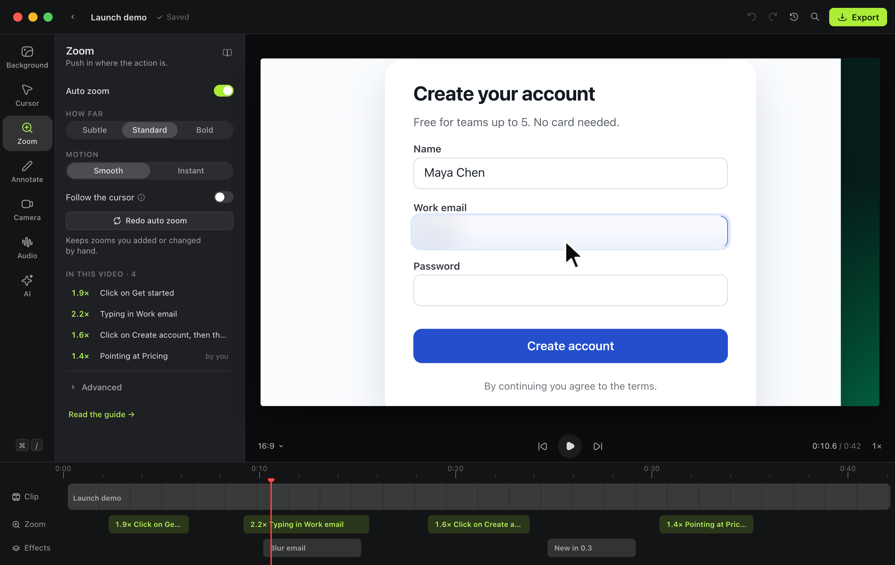

# Auto zoom

Auto zoom reads your clicks, your typing, the control you used and what changed on screen, then pushes the camera in
on each moment. Every zoom says why it's there, and every one is yours to change.

## How it decides

Most recorders centre a zoom on the cursor at every click. That frames half a button when the click lands near an
edge, and ignores what the click caused. Auto zoom reads several signals instead:

| Signal | What it frames |
| --- | --- |
| A click | The control under the click, or an area around the pointer |
| Typing | The field being typed into |
| A screen change after a click | The control **and** the result that appeared |
| A pause | Where the pointer rested, when nothing was clicked |

- The camera is fully in just before the moment and holds through it, so the picture is still while you click or
  type. It eases in before and out after.
- Moments close in time and place merge into one zoom, so a busy minute becomes a few calm shots instead of a cut
  every second.
- Only what happens in the recorded area counts. A click beside a recorded window, typing into another app, or the
  click that stops the recording makes no zoom.

Each zoom on the timeline carries its reason, such as "Click on Export" or "Typing in Search".

> [!NOTE]
> On a Mac, auto zoom notices clicks and typing through the **Accessibility** permission, so turn it on for the best
> zooms. See [Permissions](permissions.md).

## The Zoom tool

Press <kbd>3</kbd> to open it.

| Setting | What it does |
| --- | --- |
| Auto zoom | Turns the automatic zooms on or off. Off, only zooms you add play |
| How far | **Subtle**, **Standard** or **Bold** |
| Motion | **Smooth** glides into each zoom, **Instant** cuts to it |
| Follow the cursor | Lets the view drift with the cursor while zoomed |
| Redo auto zoom | Plans the zooms again from the recording |

Under **Advanced**:

| Setting | What it does |
| --- | --- |
| Hold after a click | How long a zoom stays after a click, 0.4 to 3 seconds |
| Merge moments closer than | Nearby zooms glide into each other instead of zooming out and back in, 0 to 4 seconds |
| Zoom while typing | A zoom on the field while you type |
| Zoom on a pause | When the cursor rests on something for a second, it's probably worth a closer look |

## Change a zoom by hand

1. Move the playhead to where you want a zoom and press <kbd>Z</kbd>.
2. Drag a zoom's edges on the timeline to make it start earlier or end later.
3. Select one and press <kbd>⌫</kbd> to remove it.

Zooms you add or change are marked **by you**, and **Redo auto zoom** leaves them alone.

> [!TIP]
> Agents can plan the zooms again too, subtle, standard or bold, with the `plan_zooms` tool. See [Agents](../agents.md).
