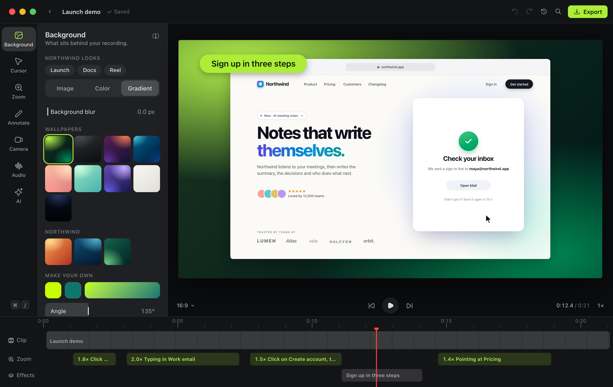

# The editor

A recording opens here with its zooms already added. Tools on the left, the picture in the middle, the timeline
below, and every tool one key away.

## The tools

Press a number to open a tool:

| Key | Tool | What it does |
| --- | --- | --- |
| <kbd>1</kbd> | [Background](background.md) | Wallpaper, padding, corners, shadow and the video's shape |
| <kbd>2</kbd> | [Cursor](cursor.md) | Size, smoothing, style, click effects, spotlight, motion blur and click sounds |
| <kbd>3</kbd> | [Zoom](auto-zoom.md) | Auto zoom, how far and how smooth, and the zooms in the video |
| <kbd>4</kbd> | [Annotate](annotate.md) | Titles, arrows, blurs and keystrokes |
| <kbd>5</kbd> | [Camera](camera.md) | The camera bubble's shape, size and corner |
| <kbd>6</kbd> | [Audio](sound.md) | Voice cleanup, silences, voice-overs and music |
| <kbd>7</kbd> | [AI](captions.md) | Captions, made on your computer |

A screenshot has two tools: Background (<kbd>1</kbd>) and Annotate (<kbd>2</kbd>).

## The timeline

- <kbd>Space</kbd> plays and pauses. <kbd>J</kbd> goes back, pauses or goes forward. <kbd>←</kbd> and <kbd>→</kbd>
  step one frame, and <kbd>Home</kbd> goes to the start.
- <kbd>S</kbd> splits the video at the playhead. Select a part you don't want and press <kbd>⌫</kbd>.
- <kbd>Z</kbd> adds a zoom at the playhead. Drag a zoom's edges to change it.
- Titles, arrows and blurs are blocks too: drag one to change when it shows.
- The speed menu next to the transport plays the preview at 0.5×, 1×, 1.5× or 2×. It doesn't change the video.

## Undo, history and the tour

- <kbd>⌘</kbd><kbd>Z</kbd> undoes and <kbd>⌘</kbd><kbd>⇧</kbd><kbd>Z</kbd> redoes.
- Every change saves itself. **Version history** (<kbd>⌘</kbd><kbd>⌥</kbd><kbd>H</kbd>) shows the earlier versions,
  so you can go back to one.
- <kbd>⌘</kbd><kbd>K</kbd> opens the command palette: every action, by name.
- <kbd>⌘</kbd><kbd>⇧</kbd><kbd>T</kbd> starts the tour, and each tool's **Show me how this works** explains it in
  place.

When it looks right, press <kbd>⌘</kbd><kbd>E</kbd> to [export](export.md).
